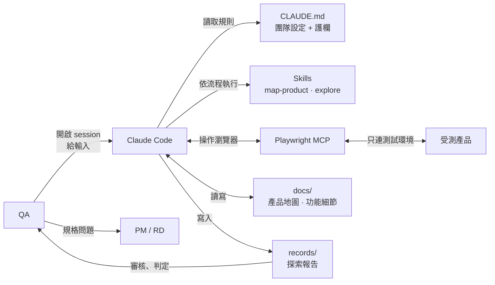
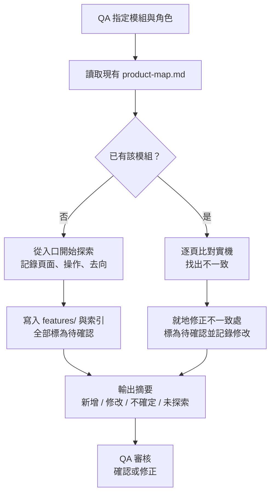
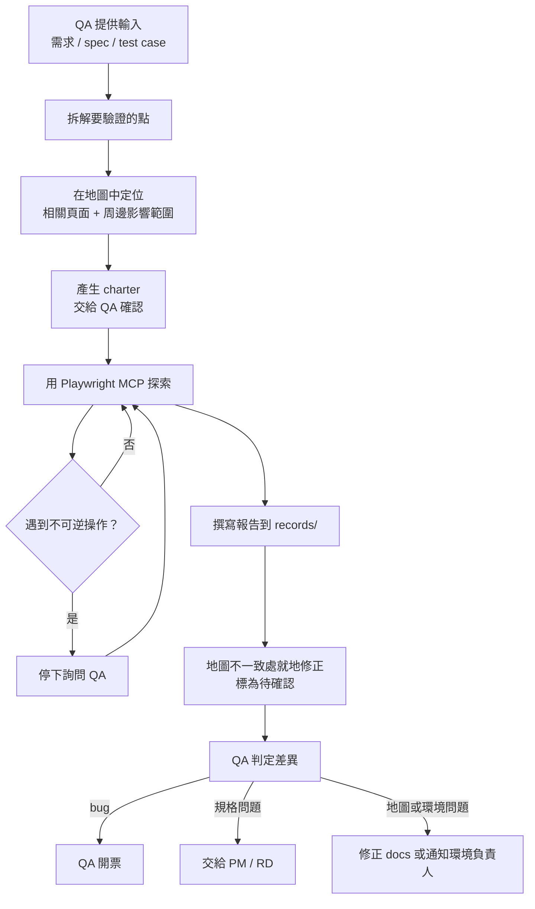

# QA Agent：產品地圖 + 探索性測試（PoC 版 v1.0）

> **宗旨**：AI 自行建立產品地圖，並針對新輸入的需求、spec、test case 進行探索性測試。 **範圍**：Web 產品。以 Claude Code（團隊訂閱方案）+ Playwright MCP 為基礎，不寫額外程式。 **通用性**：skill 只寫做法、不寫產品知識；產品知識由 AI 寫進 `../docs`；換團隊只改 `CLAUDE.md`。

---

## 1. 架構



**目錄結構**

```
qa-agent/
├── CLAUDE.md                  # 團隊設定 + 護欄（換團隊只改這裡）
├── .mcp.json                  # Playwright MCP 設定
├── .claude/skills/
│   ├── map-product/SKILL.md   # 建立 / 更新產品地圖
│   └── explore/SKILL.md       # 依輸入做探索性測試
├── docs/                      # AI 產生的知識庫
│   ├── product-map.md         # 索引：模組、頁面、入口、主要流程、角色
│   └── features/              # 各功能細節（從索引連過去）
│       └── <module>/<feature>.md
├── inputs/                    # 放需求、spec、test case（可選，也可直接貼在對話中）
└── records/                   # 每次探索的報告
    └── YYYY-MM-DD-<topic>.md
```

**角色分工**

| 角色 | 負責 |
| --- | --- |
| Claude Code + Playwright MCP | 操作產品、建立與修正地圖、執行探索、撰寫報告 |
| Skills | 規定流程與輸出格式，不含產品知識 |
| `../CLAUDE.md` | 團隊專屬設定與護欄 |
| QA | 開啟 session、提供輸入、審核報告、判定差異、確認地圖內容 |
| PM / RD | 裁決「規格與實作不符」的項目 |

---

## 2. 共通規則

這些規則同時寫進 `../CLAUDE.md`，兩個 skill 都必須遵守。

1. **AI 不下結論。** 差異只能列出可能原因，由人判定是環境資料、地圖過時、規格與實作不符，還是 bug。
2. **區分已確認與待確認。** AI 寫入的內容一律標為「待確認」，只有人可以改成「已確認」。
3. **單次結果不是規則。** 每條觀察都要附上環境、版本或 build、角色、日期。
4. **測試資料不等於產品規則。** `../CLAUDE.md` 中宣告為資料驅動的內容（條款、文案、價格、banner），出現不一致時優先懷疑環境資料。
5. **就地修正，不另開新檔。** 地圖與實機不一致時，修改原本的段落。
6. **只修改 `../docs` 和 `records/`。** 不修改 PM 規格或任何外部文件。規格與實作不符時，整理證據交給人。
7. **文件過大就拆分。** 索引不超過 200 行、功能檔不超過 300 行，把獨立主題拆成子文件，原檔只留摘要與連結。
8. **不可逆操作先問人。** 送出、刪除、付款、變更設定、寄出通知等動作，執行前必須停下來詢問。

---

## 3. 工作流一：map-product（建立產品地圖）



**原則**

- 一次只處理一個模組，避免 context 與額度用盡。
- 粒度是「頁面與流程」，不追求列出所有狀態。
- 會送出資料的動作只記錄「這裡有送出動作，會做什麼」，不實際執行。
- 遇到需要登入、權限、特定資料才能看到的頁面，記錄在「未探索」中，不要猜測內容。
- 只記錄導航資訊

**產出格式：`product-map.md`（索引）**

```markdown
# Product Map
最後更新：2026-10-05 ｜ 環境：staging ｜ 版本：a1f3c9e

## 模組
| 模組 | 入口 | 主要頁面 | 角色 | 細節 | 狀態 |
|---|---|---|---|---|---|
| 結帳 | /cart | 購物車、付款、完成頁 | member | [checkout](features/checkout/) | 待確認 |

## 主要流程
- 購物流程：首頁 → 商品頁 → 購物車 → 付款 → 完成（詳見 features/checkout/flow.md）

## 未探索
- /admin/**：缺少 admin 帳號
```

**產出格式：`features/<module>/<feature>.md`**

```markdown
# 付款頁
- 路徑：/checkout/:id/payment
- 入口：購物車頁「前往結帳」
- 角色：member（guest 會被導向登入頁）

## 頁面內容與操作
| 項目 | 行為 | 去向 | 狀態 | 證據 |
|---|---|---|---|---|
| 優惠碼欄位 + 套用 | 送出動作（未執行） | — | 待確認 | staging / a1f3c9e / member / 2026-10-05 |
| 前往付款 | 送出動作（未執行） | 完成頁（推測） | 待確認 | 同上 |

## 資料驅動內容
- 付款條款文案（來自 CMS，不一致時優先懷疑環境資料）

## 修改紀錄
- 2026-10-05：初次建立（AI）
```

---

## 4. 工作流二：explore（探索性測試）



**Charter 格式（探索前先給 QA 確認）**

```markdown
## Charter
- 輸入來源：SHOP-1234 優惠碼功能
- 要驗證的點：
  1. 輸入有效優惠碼後折抵 10%
  2. 無效優惠碼顯示錯誤
  3. 不可與會員折扣疊加
- 進入點：商品頁 → 購物車 → 付款頁（member）
- 周邊影響：購物車金額、完成頁金額、訂單紀錄
- 需要的資料：有效優惠碼 1 組、無效優惠碼、具會員折扣的帳號
- 可能需要的不可逆操作：套用優惠碼（會消耗）、送出訂單
- 預計步數上限：60
```

**探索時的啟發法（寫在 skill 裡）**

- 正常路徑先走通，再嘗試邊界與異常
- 邊界值、空值、超長輸入、特殊字元
- 重複操作、快速連續點擊、上一頁後再操作、重新整理
- 換角色、未登入狀態直接進入網址
- 同一筆資料在不同頁面顯示是否一致（金額、數量、狀態）
- 觀察 console 錯誤與失敗的網路請求

**報告格式：`records/YYYY-MM-DD-<topic>.md`**

```markdown
# 探索報告：優惠碼功能
- 輸入：SHOP-1234
- 環境：staging ｜ 版本：a1f3c9e ｜ 角色：member ｜ 日期：2026-10-05
- 執行者：Claude Code（QA：王小明 陪同）

## 符合
- 驗證點 2：無效優惠碼顯示「優惠碼不存在」

## 差異
### D1 購物車與付款頁金額不一致
- 觀察：購物車顯示 $1,080，付款頁顯示 $1,200
- 步驟：商品頁 → 加入購物車 → 套用 SAVE10 → 前往付款
- 證據：screenshot-01.png、screenshot-02.png
- 可能原因：付款頁未套用折扣（實作）／優惠碼僅限購物車頁（規格未寫明）／測試資料設定
- 判定：（由 QA 填寫）

## 未能測試
- 驗證點 3：缺少具會員折扣的測試帳號

## 待確認問題（需 PM / RD 回答）
- 優惠碼套用後重新整理頁面，折扣是否應保留？規格未提及

## 地圖修正
- features/checkout/payment.md：新增「優惠碼欄位」項目（待確認）
```

---

## 5. 護欄

PoC 階段採用三層，第三層屬於 prompt 層級，非強制執行，因此探索時 QA 需要在場。

| 層級 | 做法 | 強制性 |
| --- | --- | --- |
| 限制網域 | Playwright MCP 設定只允許連往測試環境 | 工具設定 |
| 專用測試資料 | 準備可被用掉、不與他人共用的測試帳號與資料 | 環境準備 |
| 不可逆操作先問 | 寫在 `../CLAUDE.md` 與 skill；Claude Code 的工具權限保持「需確認」 | Prompt + 人工確認 |

需要讓 AI 長時間無人值守運作，或大量執行寫入操作時，再加入網路層的強制護欄（見第 9 節）。

---

## 6. 檔案範本

### 6.1 `../CLAUDE.md`

```markdown
# QA Agent

## 目標環境
- 網址：https://staging.example.com
- 禁止連往：正式環境、任何非上述網域
- 測試帳號：見 .auth/README.md（不要把密碼寫進 docs 或 records）
- 角色：guest、member、admin

## 資料驅動內容
以下內容來自 CMS 或測試資料，不一致時優先懷疑環境資料，不視為產品規則：
- 條款與隱私權文案、首頁 banner、商品價格與庫存

## 禁止事項（不論任何理由）
- 付款、刪除帳號、修改後台全域設定

## 需先詢問 QA 的操作
- 任何送出表單、套用會消耗的資源（優惠碼、點數）、寄出通知、修改設定

## 共通規則
1. 不下結論：差異只列可能原因，由人判定
2. AI 寫入的內容一律標為「待確認」
3. 每條觀察附上環境、版本、角色、日期
4. 地圖不一致時就地修正，不另開新檔，並記錄修改
5. 只修改 docs/ 與 records/，不修改任何外部文件
6. 單一檔案超過 500 行時拆分，原檔只留摘要與連結

## 文件索引
- 產品地圖：docs/product-map.md
- 探索報告：records/
```

### 6.2 `../.mcp.json`

```json
{
  "mcpServers": {
    "playwright": {
      "command": "npx",
      "args": [
        "@playwright/mcp@latest",
        "--allowed-origins", "https://staging.example.com",
        "--output-dir", "records/artifacts"
      ]
    }
  }
}
```

> 參數名稱與可用選項請以 Playwright MCP 官方文件為準，版本更新時可能變動。

### 6.3 `../.claude/skills/map-product/SKILL.md`

```markdown
---
name: map-product
description: 建立或更新產品地圖。當使用者要求探索某個模組、建立產品地圖、或更新 docs/product-map.md 時使用。
---

# 建立 / 更新產品地圖

## 開始前
1. 確認本次要處理的模組與角色；使用者沒說明就先詢問
2. 讀取 docs/product-map.md 與該模組現有的 features/ 檔案
3. 記下環境與版本（從頁面、footer 或詢問使用者取得）

## 探索
- 一次只處理一個模組
- 從模組入口開始，記錄每個頁面的：路徑、入口、主要操作、去向、可見角色
- 會送出資料的操作：只記錄「有送出動作，推測會做什麼」，不實際執行
- 需要登入、權限或特定資料才能進入的頁面：記錄到「未探索」，不要猜測內容
- 已有內容的頁面：逐項比對，只修正不一致的地方

## 寫入
- 依 docs 既有格式寫入；新模組建立 features/<module>/ 目錄
- 所有新增或修改的內容標為「待確認」並附上證據（環境 / 版本 / 角色 / 日期）
- 修改既有內容時，在該檔的「修改紀錄」加一行
- 單一檔案超過 500 行時，提出拆分方案並詢問使用者

## 結束時輸出
- 新增了哪些頁面
- 修改了哪些內容（修改前 → 修改後）
- 不確定的地方
- 未探索的地方與原因
```

### 6.4 `../.claude/skills/explore/SKILL.md`

```markdown
---
name: explore
description: 依照需求、spec 或 test case 對產品進行探索性測試，並產出報告。當使用者提供新功能需求、規格、測試案例，或要求驗證某個功能時使用。
---

# 探索性測試

## 1. 理解輸入
- 讀取使用者提供的需求、spec 或 test case
- 拆解出具體要驗證的點；不清楚的地方列為「待確認問題」，不要自行假設

## 2. 定位
- 在 docs/product-map.md 中找出相關頁面與流程
- 列出可能受影響的周邊區域
- 地圖中沒有的頁面，探索時順便補上（標為待確認）

## 3. Charter
- 依格式產生 charter（驗證點、進入點、周邊影響、需要的資料、可能的不可逆操作、步數上限）
- **交給使用者確認後才開始探索**

## 4. 探索
- 先走通正常路徑，再依啟發法嘗試邊界與異常
- 每一步截圖保存到 records/artifacts/
- 留意 console 錯誤與失敗的網路請求
- 遇到 CLAUDE.md 中「需先詢問」的操作：停下來詢問
- 遇到「禁止事項」：不執行，記錄到「未能測試」
- 達到步數上限即停止，未完成的部分記錄到「未能測試」

## 5. 報告
- 依格式寫入 records/YYYY-MM-DD-<topic>.md
- 差異只列「可能原因」，「判定」欄位留空給 QA
- 涉及資料驅動內容的差異，把「環境資料」列為第一個可能原因

## 6. 地圖修正
- 探索中發現地圖與實機不一致：就地修正 docs，標為待確認，並在報告的「地圖修正」段落列出
- 規格與實作不一致：不修改任何規格文件，只寫進報告的「差異」與「待確認問題」
```

---

## 7. 動工步驟

| 步驟 | 內容 | 完成條件 |
| --- | --- | --- |
| 1. 政策確認 | 確認公司允許使用的方案、席位可使用 Claude Code、哪些資料可以送出 | 取得書面或明確同意 |
| 2. 環境準備 | 測試環境網址、各角色的專用測試帳號、可被消耗的測試資料 | 帳號可登入、資料可重建 |
| 3. 建立專案 | 建立目錄、`../CLAUDE.md`、`.mcp.json`、兩個 skill | Claude Code 能啟動 Playwright MCP 並開啟測試環境 |
| 4. 試跑 map-product | 挑一個中等複雜度的模組 | 產出地圖並經 QA 審核 |
| 5. 試跑 explore | 用該模組的一份真實需求 | 產出報告並經 QA 判定 |
| 6. 調整 skill | 依試跑結果修改流程與格式 | 第二次試跑時問題明顯減少 |

---

## 8. PoC 驗證（建議兩週，一個模組）

| 問題 | 怎麼衡量 |
| --- | --- |
| 地圖有沒有用？ | 請熟悉產品的 QA 審核：漏掉幾個頁面或流程、錯了幾處；花費時間與額度 |
| 探索有沒有價值？ | 用 3 到 5 份真實需求：找出的差異中，真正的問題有幾個、誤報幾個、有沒有人工也沒發現的 |
| 維護是否可行？ | 產品改版後重跑 map-product：修正是否正確、是否開始出現重複或矛盾的內容 |
| 護欄是否足夠？ | 統計 AI 停下詢問的次數、有沒有未經詢問就執行的不可逆操作 |
| 成本 | 每次 session 的時間與額度消耗、QA 陪同與審核的時間 |

**每次試跑後記錄**

```markdown
- 日期 / 模組 / 輸入：
- 耗時 / 額度感受：
- 地圖：漏 _ 處、錯 _ 處
- 探索：差異 _ 個（真問題 _、誤報 _）
- 護欄：詢問 _ 次、違規 _ 次
- 需要調整的 skill 內容：
```

---

## 9. 之後再考慮的擴充

PoC 結果出來前不做，以下是觸發條件：

| 擴充 | 什麼情況下需要 |
| --- | --- |
| 網路層強制護欄（proxy） | 需要 AI 無人值守運作，或大量執行寫入操作 |
| 程式化爬蟲與版本比對 | AI 維護地圖變得不穩定、太耗額度，或需要自動偵測改版 |
| 依輸入產生 test case | 探索流程穩定，且團隊需要把探索結果轉成正式案例 |
| 轉成自動化腳本 | 需要 regression，且 test case 格式已穩定 |
| CI 自動執行 | 需要部署後自動跑，並取得 API 帳號 |
| 結構化資料庫 | markdown 已難以管理（檔案過多、查詢困難） |