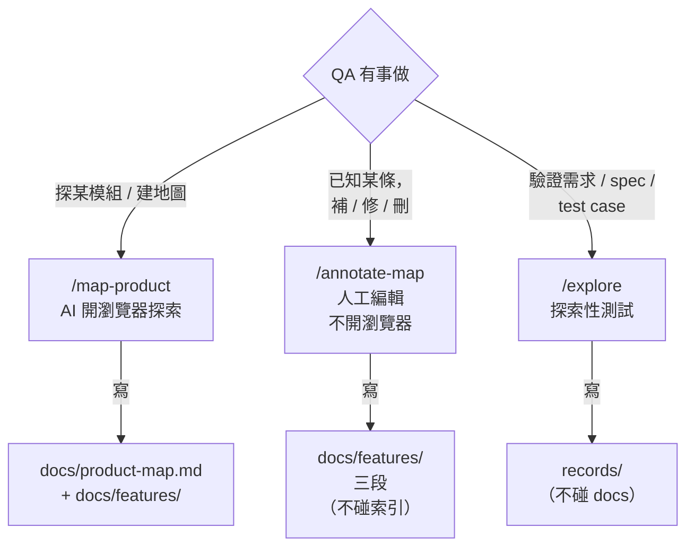
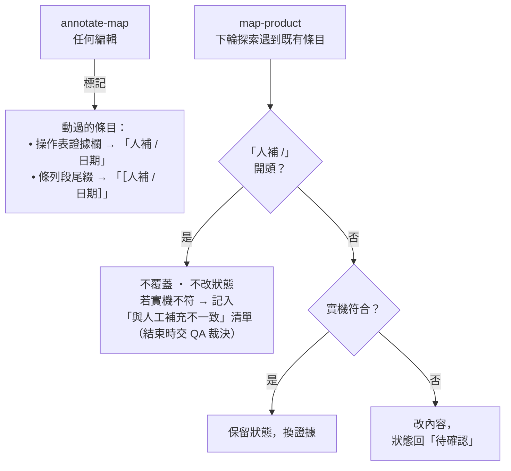

# 工作流程

> 給人閱讀的流程文件。AI 不讀 `design/`（CLAUDE.md 共通規則 #9），所以此檔只影響人的理解，不影響 skill 執行。
> 與正式規則有出入時，以 `.claude/skills/*/SKILL.md` 和 `CLAUDE.md` 為準。

---

## 1. 架構總覽（Mermaid）

```mermaid
flowchart LR
    QA["QA"]
    CC["Claude Code"]
    CM["CLAUDE.md<br/>護欄 + 詢問協定<br/>+ Checkpoint 格式"]
    PW["Playwright MCP"]
    APP["受測產品<br/>（限 allowed-origins）"]

    MP["map-product<br/>AI 自動探索"]
    AM["annotate-map<br/>QA 人工補充"]
    EX["explore<br/>需求驗證"]

    IDX["docs/product-map.md<br/>索引"]
    FEAT["docs/features/<br/>頁面檔<br/>（三段：操作表 /<br/>相關網路請求 / 資料驅動內容）"]
    REC["records/<br/>探索報告"]

    QA -->|輸入 / 口述| CC
    CC -->|遵守| CM
    CC --> MP
    CC --> AM
    CC --> EX
    MP <--> PW
    EX <--> PW
    PW <--> APP
    MP -->|讀寫| IDX
    MP -->|讀寫| FEAT
    AM -->|只寫| FEAT
    AM -.->|讀，不寫| IDX
    EX -->|只寫| REC
    EX -.->|讀，不寫| IDX
    EX -.->|讀，不寫| FEAT
    IDX -->|審核| QA
    FEAT -->|審核| QA
    REC -->|審核| QA
```



---

## 2. QA 什麼時候跑哪個 skill（Mermaid）



---

## 3. map-product × annotate-map 怎麼不打架（Mermaid）



---

## 4. ASCII 線性流程（備用，與第 1~3 張等價）

### 主流程

```
map-product ──自動探索──▶ docs/features/ ◀── annotate-map ──人工補 / 改 / 刪
                                │                 │
                                │                 │ 動過的條目標「人補 / 日期」
                                │
                                │ explore 讀地圖找定位
                                ▼
                            explore ──跑測試──▶ records/
                                                  │
                                                  │ 報告含「建議的地圖修正」
                                                  ▼
                                            【QA 看過，決定】
                                                  │
                                   ┌──────────────┴──────────────┐
                                   │                             │
                              「我已經知道」                 「請 AI 重探」
                                   ▼                             ▼
                              annotate-map                   map-product
                                                           （第二次跑）
                                   └──────────────┬──────────────┘
                                                  ▼
                                             docs/ 被更新
```

### 「人補」標記的保護機制（map-product 遇到既有條目）

```
既有條目證據欄或尾綴以「人補 /」開頭？
   │
   ├── 是 ──┬── 實機符合 ──▶ 跳過，不覆蓋
   │        │
   │        └── 實機不符 ──▶ 記入「與人工補充不一致」清單 ──▶【QA 裁決】
   │
   └── 否 ──┬── 實機符合 ──▶ 保留狀態，換新證據
            │
            └── 實機不符 ──▶ 改內容，狀態回「待確認」
```
